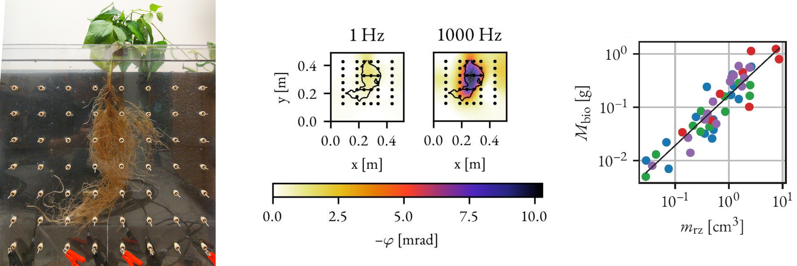

## Electrical Root Imaging and Phenotyping

### Rhizotron-Scale Quantification of Root Traits

One part of my research focused on establishing a relationship between the tomographic polarization response of plant roots and their corresponding biomass. In a phenotyping study conducted at the Lawrence Berkeley National Laboratory, we could show that the spatially resolved total polarizability of pinto bean, black bean, soy bean and maize root systems is strongly correlated with their corresponding root biomass. This study was published 2024 in [*Plant Methods*](https://doi.org/10.1186/s13007-024-01247-7).

### Field-Scale Sensing of Root Structure

### Field-Scale Sensing of Root Nutrient Uptake
